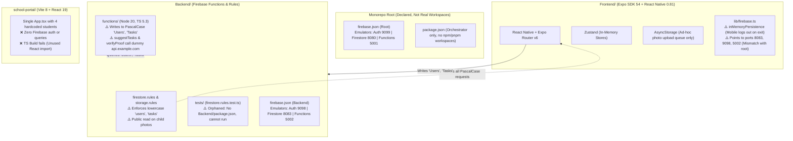

# 🔍 KidQuest Comprehensive Audit Report (Phase 0)

**Date:** October 20, 2026  
**Auditor:** Senior React Native & Firebase Systems Engineer  
**Repository:** `amar-kumar-cse/KidQuest`  
**Target:** Production-Ready, COPPA/DPDP-Compliant Android & iOS App  

---

## 1. Executive Summary

KidQuest has a solid UI foundation (Expo SDK 54, Expo Router, NativeWind) and working frontend unit tests (51/51 passing). However, the repository currently sits in a **fragile prototype state with critical blockers**:
1. **Fatal Schema Mismatch:** Security rules (`Backend/firestore.rules`) protect a lowercase schema (`users`, `tasks`) while both the mobile app and Cloud Functions write to PascalCase (`Users`, `Tasks`). Deploying these rules will immediately crash 100% of client operations with `PERMISSION_DENIED`.
2. **Auth Persistence Bug:** Native mobile Firebase Auth is configured with `inMemoryPersistence`. Users get logged out every time the app closes.
3. **Broken CI & Orphaned Rules Tests:** CI claims to test Firestore rules but actually reruns a frontend service test. The actual rules test suite (`Backend/tests/`) cannot execute because `Backend` lacks a `package.json` and `@firebase/rules-unit-testing` is nowhere in `node_modules`.
4. **School Portal is a Mock Prototype:** The educator portal is an unintegrated static React component with a failing TypeScript build (`TS6133`).
5. **COPPA / Child Privacy Vulnerabilities:** Storage rules allow any signed-in user to view all child task proof photos; kids are registered with individual emails and passwords instead of parent-managed profiles.

---

## 2. Actual Architecture vs. Declared Architecture



### Key Architectural Findings:
- **Pseudo-Monorepo:** `package.json` at root is named `kidquest-monorepo`, but lacks `workspaces: ["Frontend", "school-portal", "Backend/functions"]`. Dependencies are siloed in 3 independent `node_modules` trees.
- **Dual Conflicting `firebase.json`:** Root `firebase.json` uses default ports (Auth 9099, Firestore 8080, Functions 5001). `Backend/firebase.json` uses custom ports (Auth 9098, Firestore 8083, Functions 5002). `Frontend/lib/firebase.ts` connects to Backend's ports, so running `npm run dev` or `npm run emulate` from root causes the mobile app to fail connecting to the emulators.
- **State Management & Offline Storage:** Zustand stores (`taskStore.ts`, `useTaskStore.ts`, `useAppStore.ts`) are purely in-memory. No SQLite or Drizzle ORM exists. The "offline queue" is a 90-line JSON array in `AsyncStorage` saving photo URIs with no retry backoff or transaction integrity.

---

## 3. Directory Audit: Live vs. Dead vs. Broken

| Directory / File | Status | Technical Reality |
|---|---|---|
| `Frontend/` | **LIVE (Active)** | Expo SDK ~54.0.36, Expo Router 6, NativeWind 4. 51 unit tests pass. |
| `Frontend/store/taskStore.ts` & `useTaskStore.ts` | **DUPLICATE** | Two separate task stores exist with redundant definitions. |
| `Backend/functions/` | **LIVE (With Mock APIs)** | Builds with `tsc`, but `suggestTasks.ts` and `verifyProof.ts` call `https://api.example.com/v1/...` instead of genuine Gemini APIs. |
| `Backend/tests/` | **BROKEN / INOPERABLE** | Rules tests import `@firebase/rules-unit-testing`, but `Backend/` has no `package.json`. Cannot run locally or in CI. |
| `Backend/scripts/` | **LEGACY / SCRATCH** | `call-complete.js`, `e2e-test.js`, `move-workspace.js`, `reset-project.js` are unmaintained manual test scripts. |
| `scripts/` (root) | **LEGACY** | Contains `move-workspace.js`, old path migration script. |
| `school-portal/` | **SEMI-DEAD / MOCK** | Prototype with mock data. Build fails (`npx tsc -b` -> `error TS6133: 'React' is declared but its value is never read`). |
| `school-portal-old/` | **DEAD / DELETED** | Was already removed in commit `67fb87e` on Aug 2, 2026. Does not exist on disk. |
| `graphify-out/` | **EMPTY** | Directory exists, but no knowledge graph is populated. |

---

## 4. Expo SDK & Dependency Health Check

### Output of `npx expo install --check`
```text
The following packages should be updated for best compatibility with the installed expo version:
  expo@54.0.36 - expected version: ~54.0.37
  expo-constants@18.0.13 - expected version: ~18.0.14
  jest-expo@54.0.17 - expected version: ~54.0.18
```

### Output of `npx expo-doctor`
```text
✖ Check that required peer dependencies are installed
  Missing peer dependency: react-native-worklets
  Required by: react-native-reanimated (~4.1.1)
  Advice: Install missing required peer dependency with "npx expo install react-native-worklets"
  (App may crash in production without this native module!)

✖ Check that packages match versions required by installed Expo SDK (3 patch version mismatches)
```

### Native Build Configuration Issues (`Frontend/app.json` & `Frontend/eas.json`):
1. **Missing `google-services.json`:** `app.json` line 21 specifies `"googleServicesFile": "./google-services.json"`. The file is missing. Any Android build (`eas build -p android`) will fail immediately.
2. **Missing EAS Project ID:** `app.json` line 72 has `"projectId": "YOUR_EAS_PROJECT_ID"`.
3. **Duplicate Sentry Plugins:** `app.json` lines 60 & 67 list both `["@sentry/react-native/expo", {...}]` and `"@sentry/react-native"`.
4. **No Environment Profiles in `eas.json`:** `eas.json` defines build profiles (`development`, `preview`, `production`) but has no environment variable bindings (`env: { EXPO_PUBLIC_APP_ENV: ... }`).

---

## 5. Security Audit: Firestore & Storage Rules

### 🚨 Blocker 1: Total Schema & Collection Name Mismatch
- `Backend/firestore.rules` declares:
  ```javascript
  match /users/{userId} { ... }
  match /tasks/{taskId} { ... }
  match /streaks/{userId} { ... }
  match /rewards/{userId} { ... }
  match /{document=**} { allow read, write: if false; }
  ```
- `Frontend/services/taskService.ts` and `Backend/functions/src/` declare:
  ```typescript
  collection(db, 'Tasks')    // Capital T!
  collection(db, 'Users')    // Capital U!
  collection(db, 'Notifications')
  collection(db, 'RewardClaims')
  ```
- **Consequence:** In Firestore, collection names are strictly case-sensitive. All client requests to `'Tasks'` and `'Users'` trigger the default deny rule (`allow read, write: if false;`).

### 🚨 Blocker 2: Parents Cannot Assign Tasks in Rules
- Line 118-124 of `Backend/firestore.rules`:
  ```javascript
  // Child can create own task; Teacher can create tasks for their students.
  // Parents CANNOT create or assign tasks directly.
  allow create: if isAdmin() || (
    isValidTaskPayload() && (
      (request.auth.uid == request.resource.data.userId) ||
      isTeacherOf(request.resource.data.userId)
    )
  );
  ```
- **Consequence:** Directly opposes the core product requirement where parents assign tasks/chores to their children.

### 🚨 Blocker 3: Field Contract Mismatch in Rules
- `firestore.rules` demands:
  `request.resource.data.keys().hasAll(['userId', 'subject', 'status', 'createdAt'])`
- `Frontend/services/taskService.ts` writes:
  `title, description, category, difficulty, xp, assignedToUid, assignedToName, parentId, status, dueDate, createdAt, updatedAt`
- Neither `userId` nor `subject` are sent by the mobile app.

### 🚨 Blocker 4: Storage Rules Leak Child Photos to Any Signed-in User
- `Backend/storage.rules` lines 32 & 47:
  ```javascript
  match /profile-photos/{userId}/{fileName} { allow read: if isSignedIn(); }
  match /task-photos/{taskId}/{fileName}    { allow read: if isSignedIn(); }
  ```
- **Consequence:** Any user with a valid Firebase Auth token (any child, parent, or third party) can download and view photos of children submitting task proof. Severe violation of **COPPA** (USA) and **DPDP Act 2023** (India).

### 🚨 Blocker 5: Client-Authoritative Gamification
- `firestore.rules` allows children to directly overwrite their streaks and balances:
  ```javascript
  match /streaks/{userId} { allow write: if isUser(userId)... }
  match /rewards/{userId} { allow write: if isUser(userId)... }
  ```
- A tech-savvy child or malicious client can grant themselves infinite streak and reward points. Gamification ledger must be 100% server-authoritative via Cloud Functions.

---

## 6. Secrets & Environment Configuration

| File | Variable | Finding / Risk |
|---|---|---|
| `.env` (root) | `EXPO_PUBLIC_GEMINI_API_KEY` | **CRITICAL RISK:** Client env vars starting with `EXPO_PUBLIC_` are compiled directly into the mobile JS bundle. Gemini API key will be extracted by anyone decompiling the APK/IPA. Must be moved to Cloud Functions Secret Manager. |
| `.env` (root) | `EXPO_PUBLIC_FIREBASE_*` | Contains dummy placeholders (`your_firebase_api_key_here`). |
| `.env.example` vs `.env.template` | Duplicate files | Two conflicting template files exist with slightly different keys. |
| `Frontend/lib/firebase.ts` | Fallback Config | Falls back to `'mock-api-key'` and `'demo-no-project'`. |
| `Backend/functions/src/ai/suggestTasks.ts` | Endpoint | Hardcoded dummy URL: `https://api.example.com/v1/generate`. |
| `Backend/functions/src/ai/verifyProof.ts` | Endpoint | Hardcoded dummy URL: `https://api.example.com/v1/vision:analyze`. |
| `Frontend/app.json` | EAS & Sentry | `"projectId": "YOUR_EAS_PROJECT_ID"`, `"organization": "your-sentry-org"`. |

---

## 7. README vs. Reality Matrix

| Feature / Area | README Claim | Actual Reality |
|---|---|---|
| **School Web Portal** | "High-efficiency teacher dashboard built with Vite and React 19... classroom assignments & progress" | 1 static mock component (`App.tsx`) with 4 hardcoded students, 0 Firebase calls, and broken TypeScript build. |
| **Offline Architecture** | "Zero-Friction Offline Support: Queue-based offline storage with auto-sync when network reconnects" | Ad-hoc 90-line `AsyncStorage` photo queue. No SQLite, no Drizzle ORM, no offline task database, no exponential backoff. |
| **Monorepo** | "Monorepo Workspace Structure: Frontend/, Backend/, school-portal/" | Root `package.json` has no `workspaces` declared; separate unlinked `node_modules` in each folder. |
| **COPPA / Child Privacy** | "Built strictly adhering to child online privacy protection principles" | Children register with individual email/password in `authService.ts`. Storage rules allow any logged-in user to see all kids' photos. |
| **Parent-Teacher Messaging** | Documented in commit log & quickstart | `database.rules.json` exists for RTDB, but mobile app has no working chat screen wired to it. |
| **Demo & Screenshots** | YouTube demo link & screenshots | Placeholder link (`YOUR_YOUTUBE_VIDEO_ID`) and placeholder images (`placehold.co`). |

---

## 8. Tests & CI/CD Status

1. **Frontend Tests:**
   - **Command:** `npm test` inside `Frontend/`
   - **Result:** **PASS** (8 test suites, 51 tests passed, runtime ~30s).
   - Tests cover: `gamification`, `taskService`, `authService`, `streakService`, `rewardService`, `taskStore`, `TaskCard`, `AISuggestionCard`.
2. **Backend / Security Rules Tests:**
   - **Command:** `npm --prefix Backend test` or `npm run test:rules`
   - **Result:** **FAIL / BROKEN.** `Backend` has no `package.json`. Test files `Backend/tests/firestore.rules.test.ts` and `rules.test.ts` fail immediately with module not found for `@firebase/rules-unit-testing`.
3. **CI Pipeline (`.github/workflows/ci.yml`):**
   - **Deceptive Test Step:** Job 2 is labeled *"Run Firebase Security Rules Test Suite with Emulator"*, but executes:
     `npm --prefix Frontend test __tests__/services/taskService.test.ts`
     It tests a frontend service inside the emulator instead of testing actual security rules!
   - **School Portal Job:** Runs `npx tsc -b --noEmit` in `school-portal`, which will fail on GitHub Actions due to the TS6133 unused `React` import.

---

## 9. Comprehensive Issues Table (Prioritized by Severity)

| ID | Issue | Severity | Impact | Remediation Plan |
|---|---|---|---|---|
| **SEC-01** | `firestore.rules` vs Frontend/Functions collection name & schema mismatch | **BLOCKER** | 100% of mobile app & Cloud Function Firestore operations fail with `PERMISSION_DENIED` if rules are deployed. | Harmonize unified schema (`parents/{uid}`, `children/{childId}`, `tasks/`, `submissions/`). Rewrite `firestore.rules` to match actual app data model. |
| **SEC-02** | `storage.rules` allows any logged-in user to read all child proof photos | **BLOCKER** | Direct COPPA & DPDP violation; unauthorized users can access minors' photos. | Restrict photo read access: only the child who uploaded, their verified linked parent, and their assigned teacher can read. |
| **AUT-01** | Mobile Firebase Auth uses `inMemoryPersistence` | **BLOCKER** | User is logged out every time the mobile app is backgrounded or closed. | Configure `initializeAuth` with `@react-native-async-storage/async-storage` via `getReactNativePersistence()`. |
| **BLD-01** | Missing `react-native-worklets` peer dependency | **BLOCKER** | Mobile app crashes on standalone native Android/iOS builds when Reanimated runs. | Install `react-native-worklets` aligned with Expo SDK 54. |
| **BLD-02** | Missing `Frontend/google-services.json` | **BLOCKER** | Android native builds via EAS fail immediately. | Add `google-services.json` template/placeholder and setup guidance in docs. |
| **BLD-03** | `school-portal` TypeScript build fails (`TS6133`) | **BLOCKER** | CI breaks and `npm run deploy:all` fails. | Remove unused `React` import in `school-portal/src/App.tsx`. |
| **TST-01** | Rules unit tests (`Backend/tests/`) cannot run & CI fakes rules test | **BLOCKER** | No automated guarantee that security rules actually protect child data. | Create proper `Backend/package.json` with `@firebase/rules-unit-testing`, Jest, and update CI. |
| **SEC-03** | `EXPO_PUBLIC_GEMINI_API_KEY` in client `.env` | **HIGH** | Secret key leakage; high financial and abuse risk. | Remove from client bundle. Shift all Gemini/AI calls strictly to Cloud Functions with Secret Manager. |
| **DAT-01** | Child accounts registered with email & password | **HIGH** | Incompatible with COPPA / under-13 onboarding and user requirement. | Shift to Parent-governed child profiles: Parent registers, creates Child profiles with PIN/Avatar. |
| **SEC-04** | Client-writeable streaks and rewards in `firestore.rules` | **HIGH** | Kids can tamper with their XP, streak, and coin balance. | Move reward claiming, streak incrementing, and XP ledger to Cloud Functions atomic transactions. |
| **ENV-01** | Conflicting emulator ports in root vs Backend `firebase.json` | **HIGH** | Local development environment is broken; frontend cannot communicate with emulators. | Standardize on root `firebase.json` and sync `Frontend/lib/firebase.ts`. |
| **OFF-01** | No real offline database (AsyncStorage queue only, no SQLite) | **HIGH** | App fails offline when querying tasks; no offline transaction synchronization. | Implement `expo-sqlite` + Drizzle ORM with an idempotent sync queue and conflict resolution. |
| **ARC-01** | Monorepo is fragmented; no workspaces configured | **MEDIUM** | Duplicate dependencies, redundant scripts, unshared TypeScript types. | Configure npm/pnpm workspaces with `@kidquest/shared` package for types and Zod schemas. |
| **STR-01** | Duplicate stores (`taskStore.ts` and `useTaskStore.ts`) | **MEDIUM** | Inconsistent state updates across different screens. | Merge into a single authoritative `taskStore.ts`. |
| **EAS-01** | `eas.json` missing multi-environment configs (dev/preview/prod) | **MEDIUM** | Inability to create isolated staging vs production builds. | Configure explicit EAS profiles with environment variables and release channels. |
| **DOC-01** | README and docs depict a finished app instead of current reality | **LOW** | Misleading developer setup instructions; broken links and placeholder videos. | Rewrite README with actual mermaid architecture, setup guide, and honest roadmap. |

---

## 10. Verification Steps Performed in Phase 0

1. **Repo Structure Inspection:** Identified root files, `Frontend`, `Backend`, `school-portal`, `.github/workflows`, `.env` files.
2. **Dependency & Expo Check:** Executed `npx expo install --check` and `npx expo-doctor` in `Frontend/`.
3. **Type-Check:** Executed `npm run type-check` in `Frontend/` (Passed), `npm run build` in `Backend/functions` (Passed), and `npm run build` in `school-portal` (Failed on TS6133).
4. **Unit Tests:** Executed `npm test` in `Frontend/` (51 tests passed).
5. **Security Rules vs. Code Audit:** Compared `Backend/firestore.rules` and `Backend/storage.rules` against `Frontend/services/` and `Backend/functions/src/`.
6. **Secrets & Config Audit:** Scanned for exposed API keys and verified `.env` files.
