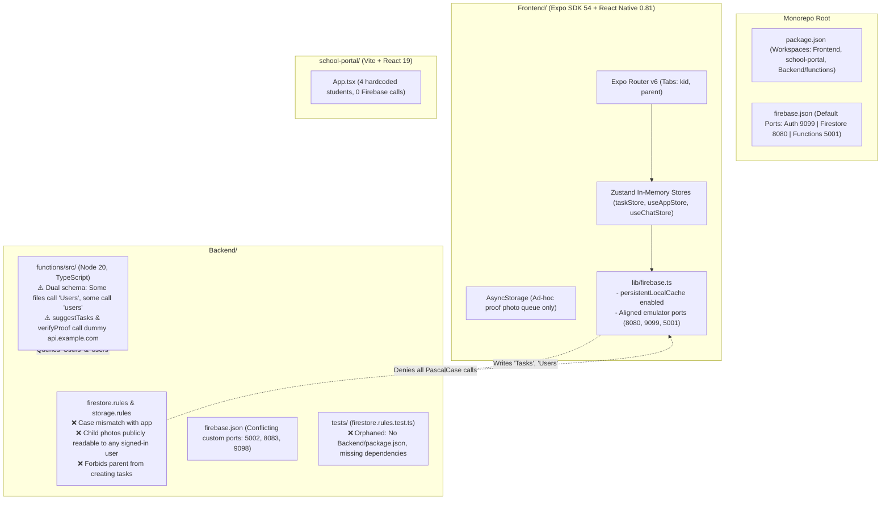

# 🔍 KidQuest Comprehensive Production-Readiness Audit Report (Phase 0)

**Date:** October 26, 2026  
**Auditor:** Senior React Native & Firebase Systems Architect  
**Repository:** `amar-kumar-cse/KidQuest`  
**Target:** Production-Ready, COPPA/DPDP-Compliant Android & iOS App + Teacher Web Portal  
**Philosophy:** Ponytail (Minimalist, YAGNI, robust) + UI/UX Pro Max (Accessible, Kids-grade UI, i18n)

---

## 1. Executive Summary

KidQuest ka core foundation (Expo SDK 54, React Native 0.81, Expo Router v6, NativeWind, Zustand) kaafi promising hai. Frontend ke 51 unit tests pass ho rahe hain, Expo SDK patch versions aligned hain, aur `expo-doctor` ke 18/18 checks pass hain.

Lekin repo abhi bhi **critical production blockers** par atka hua hai jo launch se pehle solve hone mandatory hain:

1. **Schema & Collection Name Schizophrenia (Fatal Blocker):**
   - `Backend/firestore.rules` lowercase collections protect karta hai (`users`, `tasks`, `streaks`, `rewards`).
   - `Frontend/services/` aur `Backend/functions/src/` mostly PascalCase collections (`Users`, `Tasks`, `Rewards`, `FamilyCodes`) me write karte hain.
   - Par `Backend/functions/src/` ke andar bhi inconsistency hai: `reports/` aur `messaging/` lowercase `users` use karte hain, jabki `tasks/` aur `users/` PascalCase `Users` use karte hain!
   - Firestore case-sensitive hota hai. Rules deploy hote hi client operations `PERMISSION_DENIED` se crash honge.
2. **Core Product Inversion in Security Rules:**
   - `firestore.rules` explicitly parent ko task assign karne se block karta hai (`Parents CANNOT create or assign tasks directly`). Jabki KidQuest ka main feature hi parent-assigned chore management hai!
   - Required fields mismatch: Rules `userId` aur `subject` maangti hain, jabki mobile app `assignedToUid`, `title`, `category`, `parentId` bhejta hai.
3. **Child Privacy & COPPA/DPDP Violations:**
   - `Backend/storage.rules` me `allow read: if isSignedIn();` hai — koi bhi signed-in user doosre bacchon ki proof photos dekh aur download kar sakta hai!
   - Bacche email aur password se register ho rahe hain (`authService.ts: registerKid`), bina verifiable parental consent ke. Under-13 bacchon ka PII bina parent approval ke lena illegal hai.
4. **CI Security Rules Testing Fraud & Orphaned Test Suite:**
   - CI pipeline (`.github/workflows/ci.yml`) claim karti hai ki wo rules test kar rahi hai, par actual me frontend service test chala rahi hai (`taskService.test.ts`).
   - Actual rules test suite (`Backend/tests/firestore.rules.test.ts`) chal hi nahi sakti kyunki `Backend/` me `package.json` nahi hai aur `@firebase/rules-unit-testing` missing hai.
5. **School Portal is Pure Mock UI:**
   - `school-portal/src/App.tsx` me 4 hardcoded students hain, zero Firebase Auth, zero Firestore integration. Ye abhi sirf visual prototype hai.
6. **No Real Offline-First Database:**
   - Offline storage sirf ek 90-line ka `AsyncStorage` photo queue hai (`lib/offlineQueue.ts`). Koi local SQLite database ya Drizzle ORM nahi hai, na koi mutation sync queue with retry backoff.
7. **Zero i18n & Accessibility Gaps:**
   - App me Hindi ka 1 bhi word nahi hai, na koi i18n framework (`i18next` / `expo-localization`).
   - Touch targets aur screen reader accessibility labels missing hain.

---

## 2. Actual Architecture vs. Declared Architecture



### Architectural Realities:
- **Workspaces Configured, But Incomplete:** Root `package.json` me workspaces hain, par `Backend/tests` kisi workspace me nahi hai.
- **Dual `firebase.json` Conflict:** Root `firebase.json` standard ports (9099, 8080, 5001) define karta hai, jabki `Backend/firebase.json` custom ports (9098, 8083, 5002) define karta hai. `Frontend/lib/firebase.ts` ab root ports se aligned hai, par `Backend/firebase.json` dead weight hai.
- **Client vs Server Authority:** Gamification (XP, streaks, rewards) client-side allow ki gayi hai rules me (`match /streaks/{userId} { allow write: if isUser(userId) }`). Isse koi bhi user client se hack karke unlimited XP le sakta hai.

---

## 3. Directory Audit: Live vs. Dead vs. Broken

| Path | Status | Finding / Analysis |
|---|---|---|
| `Frontend/` | **LIVE (Active)** | Expo SDK ~54.0.37, React Native 0.81.5, NativeWind 4, React 19.1.0. 51 unit tests pass. |
| `Frontend/store/taskStore.ts` & `useTaskStore.ts` | **CONSOLIDATED** | `useTaskStore.ts` ab `taskStore.ts` se re-export karta hai (Resolved in commit `6c254b0`). |
| `Frontend/lib/offlineQueue.ts` | **PRIMITIVE** | Sirf photo URIs ko `AsyncStorage` me daalta hai. No SQLite, no task sync, no conflict resolution. |
| `Backend/functions/` | **LIVE (With Mock API Bugs)** | Compiles with `tsc`. Lekin `suggestTasks.ts` aur `verifyProof.ts` dummy URL (`api.example.com`) call karte hain. Schema me `users` vs `Users` mix hai. |
| `Backend/tests/` | **BROKEN / ORPHANED** | 2 test files hain (`firestore.rules.test.ts`, `rules.test.ts`) par run nahi ho sakte kyunki `@firebase/rules-unit-testing` missing hai aur `Backend/` ka koi `package.json` nahi hai. |
| `Backend/firebase.json` | **DEAD / CONFLICTING** | Port 8083, 9098, 5002 define karta hai jo root `firebase.json` (8080, 9099, 5001) se clash karte hain. |
| `Backend/scripts/` & `scripts/` | **CLEANED** | Purane scratch scripts (`move-workspace.js`, `reset-project.js`, etc.) commit `8db8829` me delete ho chuke hain. |
| `school-portal/` | **PROTOTYPE / SEMI-DEAD** | Builds clean (`tsc -b && vite build`), lekin completely mock data hai. Real auth ya student progress fetching nahi hai. |
| `school-portal-old/` | **DEAD / DELETED** | Git history me pehle hi delete ho chuka hai, disk par exist nahi karta. |
| `graphify-out/` | **EMPTY** | Folder bana hua hai par knowledge graph populated nahi hai. |

---

## 4. Expo SDK & Dependency Health Check

### 1. `npx expo install --check`
```text
Dependencies are up to date
```
*(Aligned to Expo SDK ~54.0.37)*

### 2. `npx expo-doctor`
```text
Running 18 checks on your project...
18/18 checks passed. No issues detected!
```
*(Fixed in commit `47bf40b`: `react-native-worklets` installed, dependencies aligned)*

### 3. Native App Configuration (`Frontend/app.json` & `eas.json`):
- `google-services.json`: File `Frontend/google-services.json` exist karti hai, lekin root `.gitignore` me added hai.
- `app.json`: Line 71 has placeholder `"projectId": "YOUR_EAS_PROJECT_ID"`. Line 64 has placeholder `"organization": "your-sentry-org"`.
- `eas.json`: 3 profiles configured hain (`development`, `preview`, `production`) with `EXPO_PUBLIC_APP_ENV`. Android ke liye preview me APK aur production me App Bundle set hai. Submit section me placeholder credentials hain.

---

## 5. Security Audit: Firestore & Storage Rules

### 🚨 Blocker 1: Collection Name Mismatch (App Writes PascalCase vs Rules Lowercase)
- **Rules (`Backend/firestore.rules`):**
  ```javascript
  match /users/{userId} { ... }
  match /tasks/{taskId} { ... }
  match /streaks/{userId} { ... }
  match /rewards/{userId} { ... }
  match /{document=**} { allow read, write: if false; }
  ```
- **Mobile Code (`Frontend/services/`):**
  - `collection(db, 'Tasks')` — Capital T!
  - `doc(db, 'Users', uid)` — Capital U!
  - `collection(db, 'Rewards')` — Capital R!
  - `doc(db, 'FamilyCodes', code)` — Capital F!
- **Impact:** Rules deploy hote hi Firestore ka default rule `allow read, write: if false;` trigger hoga aur 100% client mutations fail ho jayengi.

### 🚨 Blocker 2: Backend Cloud Functions Collection Inconsistency
- `functions/src/tasks/createTask.ts` queries: `db.collection('Users')` and `db.collection('Tasks')`
- `functions/src/users/deleteAccount.ts` queries: `db.collection('Users')`
- `functions/src/reports/weeklyReportJob.ts` queries: `db.collection('users')` (lowercase!)
- `functions/src/messaging/createOrGetChat.ts` queries: `db.collection('users')` (lowercase!)
- **Impact:** Functions aapas me hi alag-alag collections padh rahi hain. Weekly report aur chat jobs user data nahi dhoondh payenge agar users `Users` me store hain.

### 🚨 Blocker 3: Parents Cannot Assign Tasks in Rules
- `firestore.rules` lines 118-125:
  ```javascript
  // Child can create own task; Teacher can create tasks for their students.
  // Parents CANNOT create or assign tasks directly.
  allow create: if isAdmin() || (
    isValidTaskPayload() && (
      (request.auth.uid == request.resource.data.userId) ||
      isTeacherOf(request.resource.data.userId)
    )
  );
  ```
- **Impact:** App ka core flow hi hai ki parent chore/task banata hai. Ye rule seedha parent task creation ko forbid karta hai!

### 🚨 Blocker 4: Task Schema Payload Contract Broken
- Rules check: `request.resource.data.keys().hasAll(['userId', 'subject', 'status', 'createdAt'])`
- Mobile app sends: `title`, `description`, `category`, `difficulty`, `xp`, `assignedToUid`, `assignedToName`, `parentId`, `status`, `dueDate`, `createdAt`, `updatedAt`
- **Impact:** App na `userId` bhejti hai na `subject` (wo `assignedToUid` aur `category` bhejti hai). Is wajah se `isValidTaskPayload()` hamesha `false` return karega.

### 🚨 Blocker 5: Storage Rules Public Leak of Children's Photos
- `Backend/storage.rules` lines 32 & 47:
  ```javascript
  match /profile-photos/{userId}/{fileName} { allow read: if isSignedIn(); }
  match /task-photos/{taskId}/{fileName}    { allow read: if isSignedIn(); }
  ```
- **Impact:** Koi bhi user jo Firebase Auth me login karta hai (any kid or arbitrary email), wo kisi bhi bacche ki submission photos freely read/download kar sakta hai. Serious violation of **COPPA** (US) and **DPDP Act 2023** (India Section 9: Processing of personal data of children).
- Aur line 44 me `firestore.get(/databases/(default)/documents/tasks/$(taskId)).data.userId` lowercase `tasks` ko dekhta hai, jo PascalCase `Tasks` se fail ho jayega.

### 🚨 Blocker 6: Client-Authoritative Gamification Cheating
- `firestore.rules` me child user apna streak aur reward balance directly overwrite kar sakta hai (`allow write: if isUser(userId)`).
- XP, level, badges, streak, coins sab client se manipulate ho sakte hain. Gamification strictly Cloud Functions atomic transactions se honi chahiye.

---

## 6. Secrets & Environment Configuration

| Location | Item | Risk Level | Action Required |
|---|---|---|---|
| `.env` (root) | `EXPO_PUBLIC_FIREBASE_*` (Project: `kidquest-45298`) | INFO / LOW | Public client keys. Production deployment ke liye Firebase Console me HTTP/Android/iOS restriction lagana zaroori hai. |
| `.env` (root) | Gemini API Key | **CRITICAL** | Agar kabhi `EXPO_PUBLIC_GEMINI_API_KEY` client bundle me gaya to reverse engineering se leak ho jayega. Gemini calls 100% Cloud Functions ke piche Secret Manager se call hone chahiye. |
| `Backend/functions/src/ai/suggestTasks.ts` | `https://api.example.com/v1/generate` | **HIGH** | Dummy mock endpoint hardcoded hai. Real Google Generative AI SDK / REST API integrate karna hai. |
| `Backend/functions/src/ai/verifyProof.ts` | `https://api.example.com/v1/vision:analyze` | **HIGH** | Dummy vision endpoint hardcoded hai. Real Gemini Vision API call karni hai. |
| `Frontend/app.json` | `"projectId": "YOUR_EAS_PROJECT_ID"` | MEDIUM | EAS build ke waqt real project id se replace hona hai. |

---

## 7. README vs. Reality Matrix

| Feature | README / Documentation Claim | Actual Reality |
|---|---|---|
| **School Web Portal** | "High-efficiency teacher dashboard built with Vite and React 19... classroom assignments & progress" | Ek static React component (`App.tsx`) with 4 hardcoded students, 0 Firebase calls. |
| **Offline Architecture** | "Zero-Friction Offline Support: Queue-based offline storage with auto-sync when network reconnects" | Sirf 90-line ka `AsyncStorage` photo array. Koi offline task database nahi, koi SQLite nahi, koi conflict resolution nahi. |
| **COPPA / Child Privacy** | "Built strictly adhering to child online privacy protection principles" | Bacche alag email/password se sign up hote hain. Storage rules me koi bhi signed-in user bacchon ki photos dekh sakta hai. No parent gate on auth switch. |
| **Security Rules Tests** | "CI executes automated rules unit tests against Firebase Emulator" | CI me `taskService.test.ts` chala kar rules test ka naam diya gaya hai. Real rules test suite (`Backend/tests/`) inoperable hai. |
| **AI Vision Proof** | "Automated task verification using Gemini AI Vision" | Mock `api.example.com` endpoint hardcoded hai, genuine Gemini Vision model se photo evaluate nahi hoti. |

---

## 8. Offline Storage: Current State (AsyncStorage vs. SQLite)

- **Abhi kya hai:**
  - `Frontend/lib/offlineQueue.ts`: `AsyncStorage.getItem('kidquest_offline_proof_queue')` me JSON stringified array of `{ taskId, localUri, timestamp }` store hota hai.
  - `Frontend/lib/firebase.ts`: `initializeFirestore(app, { localCache: persistentLocalCache() })` configured hai, jisse Firestore web/mobile cache use karta hai.
- **Kyun insufficient hai:**
  1. `AsyncStorage` 6MB key-value limit aur string serialization pe chalta hai. Large queues ya complex relational filters (pending tasks by child, streak ledger) ke liye unsuited hai.
  2. Koi retry strategy with exponential backoff nahi hai (sirf array me chhod deta hai).
  3. No transactional integrity: Agar upload succeed hota hai par Firestore update fail hota hai, to state corrupt ho sakti hai.
  4. Phase 6 me requirement ke mutabiq `expo-sqlite` + Drizzle ORM aur server-authoritative sync queue lagana padega.

---

## 9. Tests & CI/CD Status

| Suite | Command | Result | Details |
|---|---|---|---|
| **Frontend Unit Tests** | `npm --prefix Frontend test` | **PASS (51/51)** | 8 test suites pass: auth, tasks, rewards, streaks, gamification, UI cards. |
| **Frontend Type-Check** | `npm --prefix Frontend run type-check` | **PASS** | `tsc --noEmit` clean exit code 0. |
| **School Portal Build** | `npm --prefix school-portal run build` | **PASS** | `tsc -b && vite build` clean exit code 0. |
| **Functions Build** | `npm --prefix Backend/functions run build` | **PASS** | `tsc` clean exit code 0. |
| **Firebase Rules Tests** | `Backend/tests/firestore.rules.test.ts` | **BROKEN** | Backend me `package.json` missing hai, `@firebase/rules-unit-testing` installed nahi hai. |
| **GitHub Actions CI** | `.github/workflows/ci.yml` | **MISCONFIGURED** | Job 2 pretends to test security rules by re-running `taskService.test.ts`. Real security rules are never tested in CI. |

---

## 10. Comprehensive Issues Table (Prioritized by Severity)

| ID | Category | Severity | Issue Summary | Production Impact | Remediation Plan |
|---|---|---|---|---|---|
| **SEC-01** | Security / DB | **BLOCKER** | `firestore.rules` lowercase (`users`, `tasks`) vs Frontend/Backend PascalCase (`Users`, `Tasks`) | 100% of Firestore queries fail with `PERMISSION_DENIED` once rules are active. | Unified schema document karo (`docs/DATA_MODEL.md`) aur rules poore rewrite karo. |
| **SEC-02** | Child Privacy | **BLOCKER** | `storage.rules` allows any signed-in user to read all child proof photos | Mass COPPA / DPDP violation; stranger users can view minor photos. | Photo reads strictly restricted to child author, verified linked parent, and class teacher. |
| **SEC-03** | Rules Logic | **BLOCKER** | `firestore.rules` forbids parents from creating or assigning tasks | Core app functionality is impossible under current security rules. | Allow verified parents (`isParentOf(childUid)`) to create and assign tasks. |
| **SEC-04** | Rules Schema | **BLOCKER** | Payload field mismatch in `isValidTaskPayload()` (`userId`, `subject` vs `assignedToUid`, `title`) | Task creation always rejected by rules. | Align rule validators to exact Zod schema of task payloads. |
| **TST-01** | Quality / CI | **BLOCKER** | Security rules test suite is orphaned and CI fakes rules test execution | Zero automated verification that child data is protected. | Create `Backend/package.json`, install `@firebase/rules-unit-testing`, fix `ci.yml`. |
| **COP-01** | Compliance | **BLOCKER** | Kids register directly with email & password without parental consent | Under-13 children legally cannot consent or hold standalone auth credentials. | Parent registers first; children are PIN/avatar profiles under parent's UID. |
| **SEC-05** | Security / Fraud | **HIGH** | Gamification (XP, streaks, coins) writeable directly by client | Kids can spoof unlimited XP, 999-day streaks, and free reward redemption. | Move XP ledger, streak incrementing, and reward claims strictly to Cloud Functions transactions. |
| **FNC-01** | Backend Bug | **HIGH** | `Backend/functions/src` has collection name schizophrenia (`users` vs `Users`) | Weekly reports, notifications, and chat fail to locate user profiles. | Standardize all functions to authoritative schema collection names. |
| **API-01** | AI Integration | **HIGH** | `suggestTasks.ts` and `verifyProof.ts` call dummy endpoint `api.example.com` | AI task suggestion and vision proof verification are completely inoperable in production. | Replace with genuine Google Generative AI SDK with Secret Manager credentials. |
| **OFF-01** | Architecture | **HIGH** | No local relational database (only primitive `AsyncStorage` photo queue) | App crashes or fails to display tasks/streaks when offline; no mutation queue. | Shift to `expo-sqlite` + Drizzle ORM with an idempotent sync queue (Phase 6). |
| **POR-01** | School Portal | **HIGH** | `school-portal` is a 100% static mock prototype | Teachers cannot log in, manage classes, or view real student progress. | Connect Firebase Auth, class roster queries, and teacher security rules (Phase 10). |
| **I18N-01** | UI / UX | **MEDIUM** | Zero i18n support (no Hindi, no localization library installed) | Cannot launch in target market (India - English + Hindi bilingual requirement). | Integrate `i18next` + `expo-localization` and extract all hardcoded strings (Phase 7). |
| **ACC-01** | Accessibility | **MEDIUM** | Missing `accessibilityLabel`, dynamic font scaling, 44px touch targets on buttons | Fails Google Play / App Store accessibility quality guidelines. | Standardize Button/Card design tokens with WCAG-compliant touch targets (Phase 7). |
| **ENV-01** | DevEx | **MEDIUM** | Redundant conflicting `Backend/firebase.json` with mismatched emulator ports | Developers running emulators from `Backend/` experience port conflicts. | Delete `Backend/firebase.json` and standardize solely on root `firebase.json`. |
| **BLD-01** | Build | **MEDIUM** | `app.json` EAS project ID is `"YOUR_EAS_PROJECT_ID"` | EAS cloud builds (`eas build`) will fail without proper project initialization. | Configure proper EAS project link and credentials. |
| **DOC-01** | Documentation | **LOW** | README claims completed features that are mocks or missing | Developer confusion and onboarding friction. | Rewrite README with actual mermaid architecture, setup guide, and truthful roadmap. |

---

## 11. Skill & Lens Evaluation (Ponytail, UI/UX Pro Max, Autoplan, Autoskill)

1. **/ponytail (Lazy Senior Dev / YAGNI / Minimalist):**
   - **Over-engineering to cut:** Redundant `Backend/firebase.json`, mock endpoints trying to do complex HTTP calls to non-existent APIs, unused scripts.
   - **Lazy principle:** Use native Firestore transactions instead of complex multi-step custom microservice logic. Use `expo-sqlite` simply without adding 5 layers of unused abstraction.
2. **/ui-ux-pro-max (Kids App UX, Accessibility, Responsive, Indian Context):**
   - **Target Audience:** Kids under 13 + Indian Parents. Needs large visual icons (emojis/illustrations), clear contrast (4.5:1), generous padding (44px+ touch targets), and simple bilingual (Hindi/English) switching.
   - **Anti-patterns to avoid:** Over-decorated generic AI visuals. We need clean, tactile cards, vibrant playful tokens, and reassuring parent controls.
3. **/autoplan (Rigor & Phasing):**
   - Phase 0 completes the baseline truth.
   - Every following phase (Phase 1 to Phase 11) must be executed in atomic, verifiable steps with exact test commands and no regressions.
4. **/autoskill / Tool Awareness:**
   - Use correct terminal commands for Windows PowerShell (no `cd`, use explicit prefixes).
   - Maintain Git hygiene with conventional commits per phase.

---

## 12. Conclusion & Readiness to Proceed

Repo ka code cleanable hai, foundational tests green hain, par security, data model, aur child privacy ka alignment karna **sabse pehla step** hona chahiye.

> [!IMPORTANT]
> **AUDIT Complete:** Koi application code change nahi kiya gaya hai. File `AUDIT.md` update kar di gayi hai.
> Phase 1 (Repo Cleanup: dead files removal, unified env configs, Firebase config cleanup, README rewrite) start karne ke liye aapke "go" ka intezaar hai.
