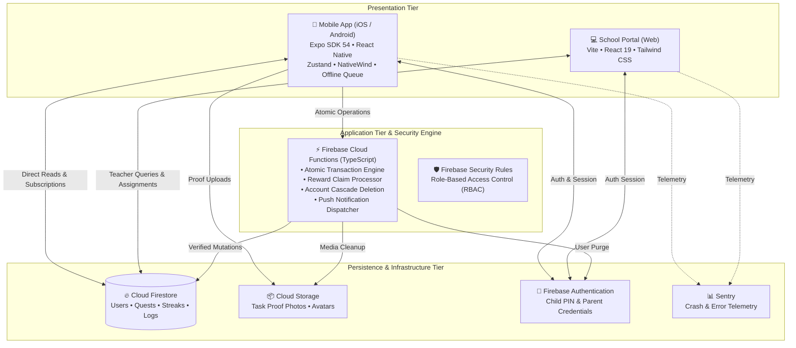

# 🎯 KidQuest

<div align="center">

**Gamified Daily Routine & Habit Tracking Ecosystem for Kids, Parents, and Schools**

A modern, production-grade cross-platform application designed to empower children to build lifelong healthy habits through engaging quest gamification — backed by a parent approval dashboard and an educator web portal.

[](https://github.com/amar-kumar-cse/KidQuest/actions)
[](https://opensource.org/licenses/MIT)
[](https://expo.dev)
[](https://reactnative.dev)
[](https://firebase.google.com)
[](https://www.typescriptlang.org)

[Explore Features](#-key-features) • [System Architecture](#-system-architecture) • [App Screenshots](#-app-screenshots) • [Quickstart Guide](#-quickstart-guide) • [Contributing](#-contributing)

</div>

---

## 📺 Live Demo

Experience the full interactive demo, walkthrough of child questing, parent verification flow, and teacher portal analytics:

<div align="center">

[](https://www.youtube.com/watch?v=YOUR_YOUTUBE_VIDEO_ID)

> 💡 *Click above to watch the end-to-end walkthrough showcasing live quest completion, streak rewards, and real-time parent approvals.*

</div>

---

## 📸 App Screenshots

<div align="center">

<table>
  <tr>
    <th width="33.33%">🎮 Child Quest Dashboard</th>
    <th width="33.33%">🏆 Rewards Vault & Streaks</th>
    <th width="33.33%">👨‍👩‍👧 Parent Control Center</th>
  </tr>
  <tr>
    <td align="center">
      
      <br />
      <em>Gamified daily routines with XP, audio text-to-speech, & visual timers</em>
    </td>
    <td align="center">
      
      <br />
      <em>Achievement badges, streak multipliers, and redeemable reward shop</em>
    </td>
    <td align="center">
      
      <br />
      <em>Photo proof verification, quest approvals, and habit analytics</em>
    </td>
  </tr>
  <tr>
    <th width="33.33%">🏫 School Portal (Web)</th>
    <th width="33.33%">🚀 Role-Based Onboarding</th>
    <th width="33.33%">⚙️ Security & COPPA Settings</th>
  </tr>
  <tr>
    <td align="center">
      
      <br />
      <em>Teacher dashboard for classroom assignments and milestone monitoring</em>
    </td>
    <td align="center">
      
      <br />
      <em>Tailored setup paths for children, parents, and school educators</em>
    </td>
    <td align="center">
      
      <br />
      <em>COPPA-compliant data privacy, biometric lock, and account deletion</em>
    </td>
  </tr>
</table>

</div>

---

## 💡 Why KidQuest?

Traditional chore charts and generic to-do apps fail with children because they lack meaningful intrinsic and extrinsic motivators. **KidQuest bridges the motivation gap** by transforming daily responsibilities (hygiene, chores, reading, homework) into an engaging RPG-style quest loop.

Parents retain total supervision through verification queues and real-time analytics, while educators seamlessly integrate school habits into the same cohesive loop.

---

## 🚀 Key Features

### 🌟 Gamified Routine & Habit Building
- **RPG Progression**: Quests grant XP, coins, and unlock achievement badges.
- **Streak Multipliers**: Encourages habit consistency with streak freezes and bonus milestones.
- **Reward Vault**: Kids spend earned coins on customizable family rewards (e.g., park visits, game time).
- **Accessibility & Speech**: Integrated **Expo Speech (TTS)** reads quest instructions aloud for pre-readers.

### 🛡️ Parent Oversight & Verification
- **Proof-of-Completion**: Children can submit photo proof using **Expo Camera / Image Picker**.
- **One-Tap Approvals**: Parents verify quest completion before rewards and XP are committed.
- **Detailed Analytics**: Weekly habit completion rates, consistency charts, and activity heatmaps.
- **Child Account Management**: Multi-child family profile switching with parent PIN lock.

### 🏫 School & Educator Companion Portal
- **Web-First Teacher Portal**: Built with React 19, Vite, and Tailwind CSS for desktop workstations.
- **Classroom Routine Sync**: Assign reading, homework, and mindfulness tasks across student cohorts.
- **Progress Tracking**: Real-time insights into student task completion and engagement levels.

### 🔒 Enterprise-Grade Privacy & Architecture
- **COPPA Compliant**: Built strictly adhering to child online privacy protection principles.
- **Zero-Friction Offline Support**: Queue-based offline storage with auto-sync when network reconnects.
- **Complete Self-Service Data Deletion**: Immediate cascade deletion of Auth credentials, Firestore docs, and Storage objects.
- **Production Observability**: Configured with **Sentry** for crash diagnostics and performance monitoring.

---

## 🏗️ System Architecture

KidQuest is designed around a decoupled, 3-tier architecture ensuring scalable performance, offline reliability, and strong authorization boundaries:



### 3-Tier Layer Breakdown:

1. **Client Tier (Mobile & Web)**:
   - **Cross-Platform Mobile App (`Frontend/`)**: Native performance powered by Expo SDK 54, file-based routing via `expo-router`, and atomic client state managed by `zustand`. An offline queue guarantees seamless usability without continuous internet connectivity.
   - **School Web Portal (`school-portal/`)**: High-efficiency teacher dashboard built with Vite and React 19, optimized for desktop resolution and bulk classroom operations.

2. **Application Tier (Firebase Cloud Functions - `Backend/`)**:
   - Isolates sensitive business logic from the client.
   - Executes atomic transactions for coin deductions and reward redemption to prevent race conditions and duplicate claims.
   - Handles scheduled notification cron jobs and asynchronous user data purging (COPPA compliance).

3. **Data Tier (Firestore, Cloud Storage & Auth)**:
   - Granular Firestore security rules restrict children from editing unapproved tasks or viewing data belonging to other families.
   - Cloud Storage organizes immutable task completion photo uploads with automatic lifecycle rules.

---

## 🛠️ Technology Stack

| Layer | Technologies |
|---|---|
| **Mobile App** | React Native 0.81, Expo SDK 54, TypeScript 5.9, Expo Router 6 |
| **Styling & UI** | NativeWind 4 (Tailwind CSS), React Native Reanimated, Linear Gradient, Expo Symbols |
| **State Management** | Zustand 5 with AsyncStorage offline synchronization |
| **Web Portal** | React 19, Vite 8, Tailwind CSS, Oxlint |
| **Backend & APIs** | Firebase Cloud Functions (Node 20 / TypeScript) |
| **Database & Auth** | Cloud Firestore (NoSQL), Firebase Authentication, Firebase Storage |
| **Hardware APIs** | Expo Camera, Image Picker, Expo Haptics, Expo Speech (TTS), Notifications |
| **Monitoring & QA** | Sentry React Native, Jest, React Native Testing Library, ESLint |

---

## 📁 Monorepo Workspace Structure

```text
KidQuest/
├── Frontend/                 # Expo React Native mobile application
│   ├── app/                  # Expo Router filesystem routes ((tabs), (parent), (auth))
│   ├── components/           # Reusable UI primitives (Quests, Badges, Celebrations)
│   ├── lib/                  # Firebase SDK config, offline queue & storage helpers
│   ├── store/                # Zustand stores (questStore, userStore, rewardStore)
│   ├── services/             # Firestore queries & mutation handlers
│   └── scripts/              # Project initialization and build scripts
├── Backend/                  # Serverless infrastructure & security
│   ├── functions/            # Cloud Functions (reward claim, account cleanup, auth triggers)
│   ├── firestore.rules       # Granular Firestore security rules
│   └── storage.rules         # Cloud Storage access rules
├── school-portal/            # React 19 + Vite web application for educators
│   ├── src/                  # Teacher dashboard views, components & auth flows
│   └── vite.config.ts        # Vite build configuration
├── docs/                     # Technical specifications, schema & architecture docs
├── scripts/                  # CI/CD & emulator development scripts
└── package.json              # Monorepo orchestration scripts
```

---

## ⚡ Quickstart Guide

### Prerequisites
- **Node.js**: `v20.x LTS` recommended
- **Package Manager**: `npm` or `yarn`
- **Expo CLI**: Installed automatically via `npx`
- **Firebase CLI**: `npm install -g firebase-tools` (for emulator testing)
- **Mobile Device or Emulator**: [Expo Go](https://expo.dev/go) on iOS/Android or Xcode Simulator / Android Studio Emulator

### 1. Clone & Install Dependencies

```bash
# Clone the repository
git clone https://github.com/amar-kumar-cse/KidQuest.git
cd KidQuest

# Install monorepo orchestration tools
npm install

# Install mobile app dependencies
cd Frontend && npm install && cd ..

# Install school portal dependencies
cd school-portal && npm install && cd ..

# Install Cloud Functions dependencies
cd Backend/functions && npm install && cd ../..
```

### 2. Environment Configuration

Create a `.env` file inside `Frontend/` by duplicating the template:

```bash
cp .env.example Frontend/.env
```

Configure your Firebase credentials:
```env
EXPO_PUBLIC_FIREBASE_API_KEY=your_api_key
EXPO_PUBLIC_FIREBASE_AUTH_DOMAIN=your_project.firebaseapp.com
EXPO_PUBLIC_FIREBASE_PROJECT_ID=your_project_id
EXPO_PUBLIC_FIREBASE_STORAGE_BUCKET=your_project.appspot.com
EXPO_PUBLIC_FIREBASE_MESSAGING_SENDER_ID=your_sender_id
EXPO_PUBLIC_FIREBASE_APP_ID=your_app_id
```

### 3. Launch the Development Environment

Run both the mobile development server and Firebase emulators concurrently:

```bash
npm run dev
```

Or run services individually:

```bash
# Start mobile app (Expo)
npm run frontend:start

# Start school portal (Vite web server)
cd school-portal && npm run dev

# Run Firebase emulators locally
npm run backend:functions:serve
```

---

## 🧪 Testing & Code Quality

KidQuest maintains strict type safety and unit testing standards:

```bash
# Type check all TypeScript files in Frontend
npm run frontend:typecheck

# Run unit tests
cd Frontend && npm test

# Run tests with code coverage
cd Frontend && npm run test:coverage

# Lint code
cd Frontend && npm run lint

# Auto-format codebase
cd Frontend && npm run format
```

---

## 🔒 Security & Privacy (COPPA)

Child privacy is core to KidQuest's product philosophy:
- **Zero Third-Party Ad Trackers**: No user tracking or behavioral advertising SDKs.
- **Parental Consent & Gated Controls**: Sensitive configuration, account edits, and payments require parent verification.
- **Account Deletion Pipeline**: Fully automated cascade deletion endpoint removing user records across Firebase Auth, Firestore, and Storage buckets on request.

---

## 🤝 Contributing

Contributions make the open-source community an incredible place to learn, inspire, and create! Any contributions you make are **greatly appreciated**.

Please review our [Contributing Guidelines](.github/CONTRIBUTING.md) for branch naming conventions, pull request workflows, and coding standards.

```bash
# 1. Fork the Project
# 2. Create your Feature Branch
git checkout -b feat/amazing-feature

# 3. Commit your Changes
git commit -m "feat(quests): add sound effect on badge unlock"

# 4. Push to the Branch
git push origin feat/amazing-feature

# 5. Open a Pull Request
```

---

## 📄 License

Distributed under the **MIT License**. See [`LICENSE`](LICENSE) for more information.

---

## 📬 Contact & Acknowledgements

**Amar Kumar** — Full Stack & Mobile Engineer  
- **GitHub**: [@amar-kumar-cse](https://github.com/amar-kumar-cse)  
- **LinkedIn**: [linkedin.com/in/amarkumarr](https://linkedin.com/in/amarkumarr)  
- **Email**: amarkrydav@gmail.com  

Project Link: [https://github.com/amar-kumar-cse/KidQuest](https://github.com/amar-kumar-cse/KidQuest)

<div align="center">

⭐ **If you find KidQuest inspiring or useful, please consider giving the repository a star!** ⭐

</div>
