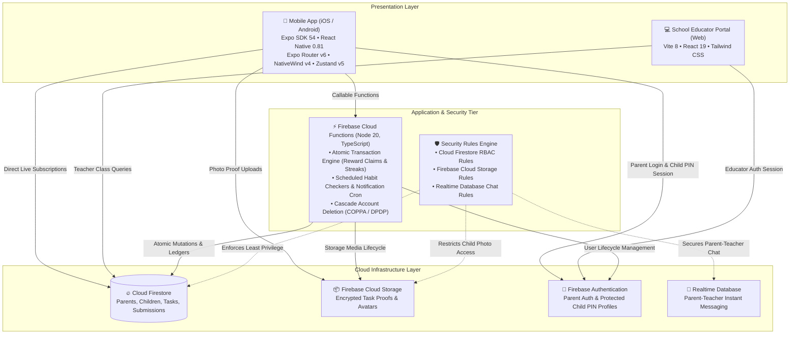

# 🎯 KidQuest

<div align="center">

**Gamified Daily Routine & Habit Tracking Ecosystem for Children, Parents, and Schools**

KidQuest transforms everyday responsibilities (morning routines, chores, homework, and reading) into an engaging RPG-style quest adventure for children — supervised by parents through real-time approvals and supported by educators via a companion school web portal.

[](https://github.com/amar-kumar-cse/KidQuest/actions)
[](LICENSE)
[](https://expo.dev)
[](https://reactnative.dev)
[](https://firebase.google.com)
[](https://www.typescriptlang.org)

[Architecture](#-system-architecture) • [App Screenshots](#-app-screenshots) • [Monorepo Structure](#-monorepo-structure) • [Quickstart Guide](#-quickstart-guide) • [Environment Variables](#-environment-configuration) • [Production Roadmap](#-production-roadmap)

</div>

---

## 🏗️ System Architecture

KidQuest is organized as an integrated monorepo connecting native cross-platform mobile apps, cloud backend triggers, and an educator management portal:



---

## 📸 App Screenshots

<div align="center">

<table>
  <tr>
    <th width="33.33%">🎮 Child Quest Feed</th>
    <th width="33.33%">🏆 Badges & Streaks</th>
    <th width="33.33%">👨‍👩‍👧 Parent Control Center</th>
  </tr>
  <tr>
    <td align="center">
      
      <br />
      <em>Daily quests, XP, visual timers, and Text-to-Speech audio support</em>
    </td>
    <td align="center">
      
      <br />
      <em>Milestone badges, streak tracking, and customizable reward store</em>
    </td>
    <td align="center">
      
      <br />
      <em>Photo proof verification, task assignment, and weekly progress analytics</em>
    </td>
  </tr>
  <tr>
    <th width="33.33%">🏫 School Educator Portal</th>
    <th width="33.33%">🔒 Child PIN Protection</th>
    <th width="33.33%">⚙️ Privacy & Account Deletion</th>
  </tr>
  <tr>
    <td align="center">
      
      <br />
      <em>Teacher dashboard for classroom assignments and student progress monitoring</em>
    </td>
    <td align="center">
      
      <br />
      <em>Parent-gated zones preventing children from bypassing chore verification</em>
    </td>
    <td align="center">
      
      <br />
      <em>One-tap account and data deletion pipeline for child privacy compliance</em>
    </td>
  </tr>
</table>

</div>

---

## 📁 Monorepo Structure

```text
KidQuest/
├── packages/
│   └── shared/               # Shared TypeScript domain types & Zod validation schemas (@kidquest/shared)
│       ├── src/
│       │   ├── types/        # User, Parent, Kid, Teacher, Task, Reward interfaces
│       │   └── schemas/      # Runtime Zod validation schemas for forms & API payloads
│       └── tsconfig.json
├── Frontend/                 # Expo SDK 54 React Native cross-platform mobile app
│   ├── app/                  # Expo Router filesystem navigation ((auth), (parent), (kid))
│   ├── components/           # Reusable UI components (TaskCard, AISuggestionCard, etc.)
│   ├── hooks/                # Custom React hooks (useTasks, useAuth, etc.)
│   ├── lib/                  # Firebase SDK singleton & native persistence helpers
│   ├── services/             # Firestore, Storage & Cloud Functions service wrappers
│   ├── store/                # Zustand client state stores (taskStore, useAppStore)
│   ├── __tests__/            # Jest + React Native Testing Library test suites (51 passing)
│   ├── app.json              # Expo application manifest
│   └── eas.json              # EAS Build & Submit profiles (development, preview, production)
├── Backend/                  # Serverless infrastructure & security
│   ├── functions/            # Firebase Cloud Functions v2 (Node 20 / TypeScript)
│   │   └── src/              # Callable endpoints, AI suggestion helpers, cron jobs
│   ├── firestore.rules       # Cloud Firestore security rules
│   ├── storage.rules         # Cloud Storage access rules
│   └── firestore.indexes.json# Composite query indexes
├── school-portal/            # Vite 8 + React 19 + Tailwind CSS educator web application
│   ├── src/                  # Teacher dashboard views & class rosters
│   └── vite.config.ts        # Vite bundler configuration
├── docs/                     # Specifications, data model, launch & deletion guides
├── .github/workflows/        # GitHub Actions CI/CD (lint, typecheck, test, EAS builds)
├── .env.example              # Consolidated environment variable template
├── firebase.json             # Firebase configuration & local emulator ports
└── package.json              # Monorepo workspaces & orchestration scripts
```

---

## ⚡ Quickstart Guide

### Prerequisites
- **Node.js:** `v20.x LTS`
- **Package Manager:** `npm` (v10+)
- **Firebase CLI:** `npm install -g firebase-tools`
- **Expo CLI:** Bundled via `npx expo`

### 1. Installation
Clone repository and install monorepo dependencies:
```bash
git clone https://github.com/amar-kumar-cse/KidQuest.git
cd KidQuest
npm install
```

### 2. Environment Configuration
Copy `.env.example` to create your local `.env`:
```bash
cp .env.example .env
cp .env.example Frontend/.env
```
Fill in your Firebase project credentials from the [Firebase Console](https://console.firebase.google.com).

### 3. Running Locally
Run both mobile and Firebase services:
```bash
# Start mobile app (Expo bundler)
npm run frontend:start

# Start school portal (Vite dev server)
npm run portal:dev

# Start Firebase emulators (Auth, Firestore, Functions, Storage, RTDB)
npm run emulate

# Build shared packages
npm run shared:build

# Run full typecheck across all 4 workspaces
npm run typecheck

# Run lint checks (Frontend + school-portal)
npm run lint

# Run unit test suites (Frontend Jest tests)
npm run test
```

---

## 🔒 Security, Privacy & Child Safety (COPPA & DPDP)

KidQuest is designed specifically for children and families with stringent privacy guardrails:
- **No Direct Child Accounts:** Children do not register with separate email/password credentials. Parents create and manage child profiles under their verified accounts.
- **Strict Photo Access Control:** Task completion photos are private and accessible only to the child who took them, their linked parent, and their classroom teacher.
- **Server-Authoritative Gamification:** XP calculations, streaks, and reward redemptions execute via atomic Cloud Functions transactions to prevent client tampering.
- **Self-Service Account & Data Deletion:** Automated cascade deletion purges user documents, child photos, and auth credentials upon parent request.

---

## 🗺️ Production Roadmap

- [x] **Phase 0:** System Architecture & Security Audit (`AUDIT.md`)
- [x] **Phase 1:** Repo Cleanup, Workspaces, and Unified Scripts
- [ ] **Phase 2:** Dependencies, Expo Doctor, and EAS Build Profiles
- [ ] **Phase 3:** Unified Data Model & Role-Based Security Rules
- [ ] **Phase 4:** Server-Side Cloud Functions Gamification Engine
- [ ] **Phase 5:** Auth, Parent PIN Gate, and Parental Consent Flow
- [ ] **Phase 6:** Offline-First Architecture (`expo-sqlite` + Sync Queue)
- [ ] **Phase 7:** UI/UX Polish, Accessibility (A11y), and Hindi/English i18n
- [ ] **Phase 8:** Gamification Store, Animations, and Parent Dashboard
- [ ] **Phase 9:** Sentry Observability, Maestro E2E, and CI/CD Pipeline
- [ ] **Phase 10:** School Portal Firebase Integration & Teacher RBAC
- [ ] **Phase 11:** Google Play Families Policy & App Store Launch Readiness

---

## 📄 License

This project is licensed under the **MIT License** — see the [LICENSE](LICENSE) file for details.
